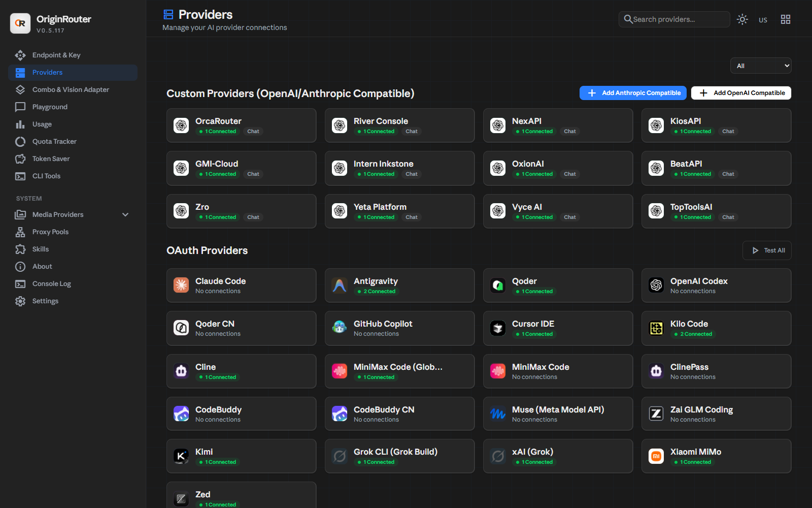
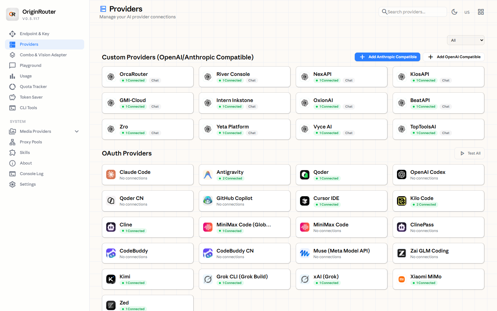
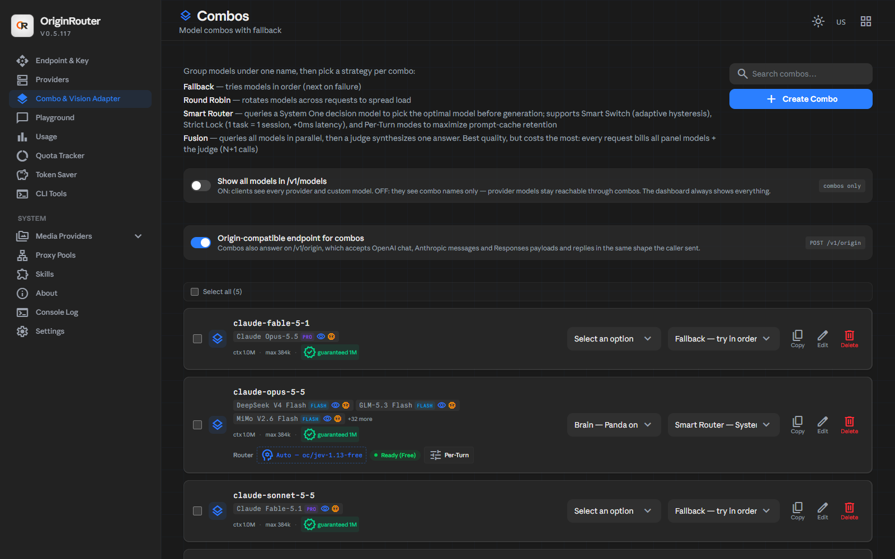
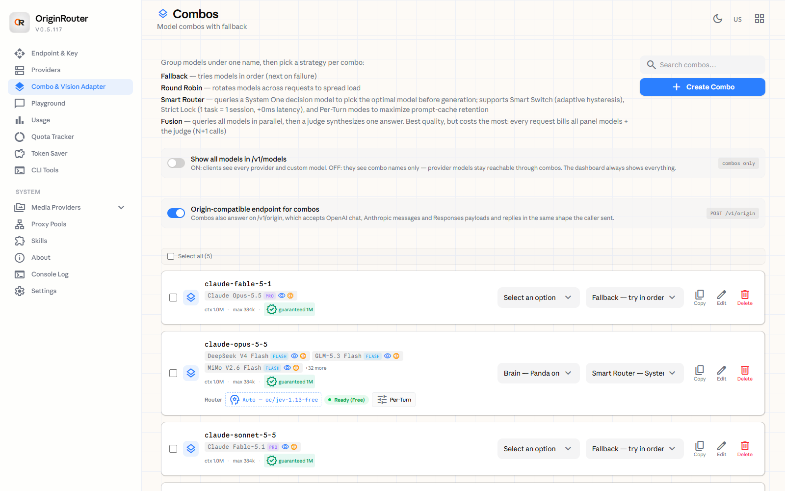
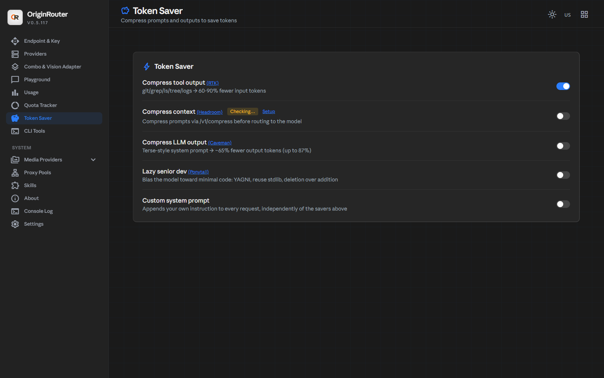
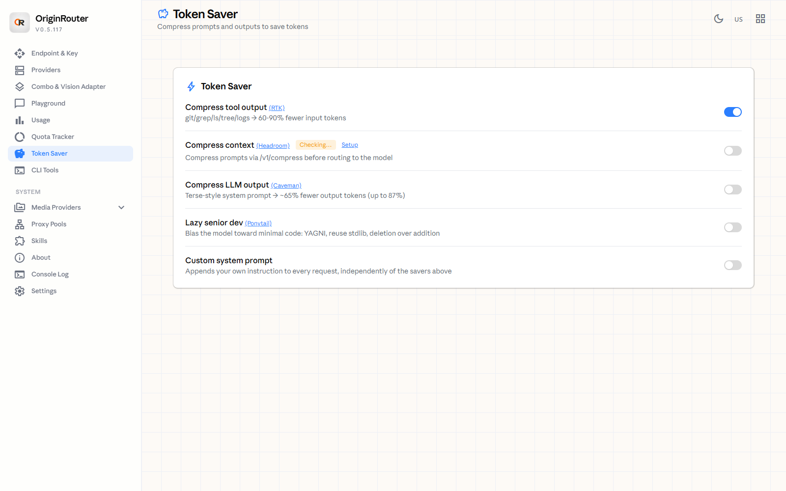

<div align="center">
  

  # OriginRouter

  **One endpoint for every AI provider. Never stop coding.**

  Route across **90+ providers** from a single local port, fall back before an upstream error ever reaches your code, and cut **60-90%** of tool-output tokens.

  <p>
    <a href="#-install"><b>Install</b></a> •
    <a href="#-the-routing-brain"><b>The Brain</b></a> •
    <a href="#-combos"><b>Combos</b></a> •
    <a href="#-token-saver"><b>Token Saver</b></a> •
    <a href="#-screenshots"><b>Screenshots</b></a> •
    <a href="#-install"><b>Install</b></a> •
    <a href="#-docs"><b>Docs</b></a>
  </p>

  [](https://github.com/origin-labs-ai/origin-router-suite/releases/latest)
  [](LICENSE)
  [](https://github.com/origin-labs-ai/origin-router-suite/pkgs/container/origin-router)
  [](https://github.com/origin-labs-ai/origin-router-suite/blob/main/docs/ARCHITECTURE.md)
  [](i18n)
</div>

---

Point Claude Code, Cursor, Codex, Cline, Gemini CLI, OpenCode, Copilot, Antigravity — anything that speaks OpenAI or Anthropic — at `http://localhost:20128`. OriginRouter answers with whichever provider is actually healthy right now, and the failure never reaches your terminal.

<div align="center">
  
</div>

---

## 📦 Install

Pick the shape that fits the machine. Every path ends the same way: the dashboard on **http://localhost:20128/dashboard**, your keys in `~/.or`, and nothing leaving the box.

### Windows — installer (recommended)

```powershell
irm https://raw.githubusercontent.com/origin-labs-ai/origin-router-suite/main/install.ps1 | iex
```

- Lands in `%LOCALAPPDATA%\Programs\OriginRouter` — **no admin rights needed** (the installer runs with the lowest privileges it can).
- Adds a **startup entry** (`HKCU\Software\Microsoft\Windows\CurrentVersion\Run`), so the gateway is up before your first tool call. It starts through a hidden PowerShell, so no console window appears.
- Adds the **system tray** icon: open the dashboard, open the gateway console, open the brain console, restart the brain, check for updates, hide.
- **Verifies the SHA256** of the download before it runs anything.
- If the npm package is not reachable, the script falls back to the release installer from GitHub.
- Remove it later through *Apps → Installed apps → OriginRouter*.

Prefer a manual download? Grab **`OriginRouter-Setup-<version>.exe`** from the [releases page](https://github.com/origin-labs-ai/origin-router-suite/releases/latest).

### macOS / Linux — one line

```bash
curl -fsSL https://raw.githubusercontent.com/origin-labs-ai/origin-router-suite/main/install.sh | bash
```

The script uses the npm package when it is reachable and falls back to the **portable build** from the release when it is not — same checksum check, no npm needed, no admin rights. It lands in `~/Applications/OriginRouter` (macOS) or `~/.local/opt/origin-router` (Linux).

Both scripts take flags when you run them from a file instead of the one-liner:

| Flag | What it does |
|---|---|
| `-Version v0.5.117` | Installs a specific release. |
| `-Portable` | Skips npm and the installer, unpacks the portable build. |
| `-SkipRun` | Downloads and verifies only, installs nothing. |

### Windows / macOS / Linux — portable zip (beta)

| Platform | Asset | Run it with |
|---|---|---|
| Windows | `OriginRouter-win-portable.zip` | `originrouter.cmd` |
| macOS | `OriginRouter-mac-portable.zip` | `./originrouter` |
| Linux | `OriginRouter-linux-portable.zip` | `./originrouter` |

Unzip anywhere and run the launcher. No installer, no admin rights, no registry — and it can live on a USB stick.

**First run asks one question: start in the system tray, or stay in the foreground?** The answer is remembered. A portable build has no installer task that could ask it, so it asks itself.

### Any platform with Node 18+

```bash
npm install -g @origin-labs-ai/origin-router
originrouter
```

Or run it without installing anything:

```bash
npx @origin-labs-ai/origin-router
```

The launcher installs a portable copy of the gateway, warms the SQLite runtime offline, writes `~/.or/install.json`, and starts the gateway on **20128**.

### Docker

```bash
docker run -d --name origin-router \
  -p 20128:20128 \
  -v origin-router-data:/app/data \
  -e DATA_DIR=/app/data \
  ghcr.io/origin-labs-ai/origin-router:latest
```

```yaml
# docker-compose.yml
services:
  origin-router:
    image: ghcr.io/origin-labs-ai/origin-router:latest
    container_name: origin-router
    restart: unless-stopped
    ports: ["20128:20128"]
    volumes: ["./data:/app/data"]
    environment:
      DATA_DIR: /app/data
```

The volume holds the SQLite database, your keys and your logs. Mount it and the container itself is stateless. Images are built for **linux/amd64** and **linux/arm64**.

### From source

```bash
git clone https://github.com/origin-labs-ai/origin-router-suite.git
cd origin-router-suite
npm install
npm run build
npm start            # gateway + dashboard on http://localhost:20128
```

The CLI package is built from `cli/` (it bundles the gateway into `cli/app`):

```bash
cd cli
npm install
npm run build
npm pack
```

Tests:

```bash
cd tests && npm install && npx vitest run
```

### Point your tools at it

```bash
# every OpenAI-compatible client
export OPENAI_BASE_URL=http://localhost:20128/v1

# every Anthropic-compatible client
export ANTHROPIC_BASE_URL=http://localhost:20128
```

Or let the launcher configure the tools for you — it writes the settings Claude Code, Codex, Cursor, Cline, Gemini CLI and the rest already use:

```bash
originrouter show claude        # what is a tool configured with right now
originrouter connect http://localhost:20128
```

`connect` also works against a **remote** OriginRouter without installing anything locally:

```bash
npx @origin-labs-ai/origin-router connect http://your-server:20128
```

### What lives where

| | |
|---|---|
| **Data, keys, usage, logs** | `~/.or/` — `db/data.sqlite`, `logs/`, `panda/`, `tunnel/`, `install.json` |
| **Install root** (installer) | `%LOCALAPPDATA%\Programs\OriginRouter` |
| **Install root** (npm) | the global npm prefix |
| **Port** | 20128 (`--port` to move it) |
| **Dashboard** | `http://localhost:20128/dashboard` |

Old installs are migrated on first start — the data folder is found, moved and kept; nothing is thrown away.

### Upgrading

| How it was installed | How it updates |
|---|---|
| **Installer** | The launcher reads the GitHub release feed, downloads `OriginRouter-Setup-<version>.exe`, verifies the `.sha256` next to it and runs the silent Inno update. npm is never trusted for updates. |
| **npm** | `npm install -g @origin-labs-ai/origin-router@latest` |
| **Docker** | `docker pull ghcr.io/origin-labs-ai/origin-router:latest`, then restart the container |

### Command reference

| Command | What it does |
|---|---|
| `originrouter` | Start the gateway and open the dashboard |
| `originrouter --tray` / `-t` | Start hidden in the system tray |
| `originrouter --port <port>` / `-p` | Run on another port (default 20128) |
| `originrouter --host <host>` / `-H` | Bind address |
| `originrouter --no-browser` / `-n` | Do not open a browser |
| `originrouter --log` / `-l` | Show the server log instead of hiding it |
| `originrouter --skip-update` | Skip the update check |
| `originrouter connect <server-url>` | Point your local tools at a remote OriginRouter |
| `originrouter show [tool…]` | Show what each tool is configured with |
| `originrouter xai video --prompt "…" --output v.mp4` | Generate a video through the running gateway |
| `originrouter --version` / `-v` | Print the version |

### If something looks wrong

| Symptom | Fix |
|---|---|
| `npm` says the package is not found | The npm package is not published for every version. Use the **release installer** or the **portable zip** — both always exist. |
| The dashboard answers `403 LAN access is disabled` | You reached it from another device. The LAN switch lives in **Settings → Endpoint**; from the same machine use `127.0.0.1`. |
| `port 20128 already in use` | `originrouter --port 20129` and point the tools at that port. |
| A tool still talks to its old endpoint | `originrouter show <tool>` prints what it is actually configured with. |
| The brain says it cannot start | The Panda orchestrator logs to `~/.or/panda/`; the desktop tray's **Open Panda Orchestrator Console** shows it. |

---

## 🧠 The Routing Brain

Most routers pick one provider and hope. OriginRouter runs a **local decision layer** that scores, classifies and steers every request before it leaves the machine.

<div align="center">
  
</div>

Three signals decide one request:

| Signal | Engine | What it contributes |
|---|---|---|
| **Rank** | **Panda** | Scores every candidate seat by `P(success)`, cost and latency; keeps the top-K, explores a little, picks the best one. |
| **Classify** | **Jev** (System One) | Reads the task itself and decides which kind of model it needs — a hard coding task, a long-context read, a cheap answer. |
| **Steer** | **Seat fairness + tier bias** | Stops one seat from eating the whole quota, and pushes a cheap task onto a cheap tier without downgrading a hard one. |

When the two engines disagree, the brain **hedges** instead of guessing: it answers from the leader and keeps the other attempt running until the deadline, so a wrong pick costs latency, not the answer.

Defaults, all overridable by env var or by the dashboard:

| Setting | Default | Env var |
|---|---|---|
| Brain mode | `merged` (`panda` \| `jev` \| `off`) | `OR_ROUTER_BRAIN` |
| Panda weight / Jev weight | `0.55` / `0.45` | `OR_PANDA_WEIGHT`, `OR_JEV_WEIGHT` |
| Brain timeout | `3500 ms` | `OR_BRAIN_TIMEOUT_MS` |
| Seat fairness | `0.3` over a 15-minute window | `OR_SEAT_FAIRNESS` |
| Tier bias (Pro vs Flash) | `0.18` | `OR_TIER_BIAS` |
| Hedge window | `12000 ms` / `64 KB` | — |
| Failover routes tried | `12` | — |
| Degrade cooldown / seat silence | `45 s` / `45 s` | — |

Everything runs **locally**. The brain never sends your prompt to a service you did not already use.

### When it is worth it

- **One key, many providers.** Keep a single paid key and let free tiers carry the cheap work.
- **Quota that resets at midnight.** The brain rotates seats so the reset actually helps you.
- **Two tiers, one name.** Point `fast` at the cheap tier and `deep` at the paid one — the brain picks per task.

---

## ⚡ Concurrency & failover

Eight agents can hit the router at once — the router is built for that, not around it.

| Knob | Default | What it does |
|---|---|---|
| **Max agents in flight** | `8` | Upstream requests served at once. The next one **queues** — it is never rejected, because a queue is slow and a rejection is an error your client would see. |
| **Requests per credential** | `2` | How many parallel requests one account may carry before the selector moves to the next connection. `1` = strict fan-out across your accounts. |
| **Admission queue** | `20 s` | How long a request may wait for a free slot before it is served anyway. Fail-open on purpose. |
| **Least-loaded selection** | on | Connections are ranked by the load they are actually carrying, not by their order in the list. |
| **Hop backoff** | `250 ms` | Jittered rest between fallback hops. Without it, eight agents walk the fleet in lockstep and hammer the same seat in the same millisecond. |
| **Failover routes** | `12` | How many alternate routes one request may try. |
| **Hedged start** | `12 s` | A client still waiting for headers this long is answered by a second seat tried in parallel — first answer wins. Small payloads only (< 64 KB), so a slow reasoning turn is never duplicated. |
| **Degrade cooldown / seat silence** | `45 s` | A seat that just refused is skipped by every concurrent request for that long. No "everyone falls back from the top" stampede. |

Tune it in **Settings → Profile → Routing resilience**, or per deployment:

```bash
OR_MAX_AGENTS_CONCURRENCY=8
OR_PER_CONNECTION_CONCURRENCY=2
OR_ADMISSION_QUEUE_MS=20000
OR_FAILOVER_ENABLED=1
```

The idea behind the whole block: **a slow answer is fine, a rejected request is not.** The router queues, spreads the load, backs off between hops, and gives up only when every route is genuinely gone — and then the last-resort policy answers, labelled as a last resort.

## 🧩 Combos

A **combo** is one name that stands for several models, with a strategy that decides how a request is served.

| Strategy | Behaviour | Costs |
|---|---|---|
| **Fallback** | Tries the models in order until one succeeds. | 1 model per request |
| **Round Robin** | Rotates across the models to spread load and burn every quota evenly. | 1 model per request |
| **Smart Router** | Asks a System One decision model which model to use *before* generating; supports adaptive switch and per-turn billing modes. | 1 extra call |
| **Fusion** | Runs every panel model in parallel and has a judge synthesise one answer. | N + 1 calls |

Combos also answer on **`POST /v1/origin`**, which accepts OpenAI chat, Anthropic messages and Responses payloads in the shape the caller sent them — so one combo can serve every client shape you have.

<details>
<summary><b>Reliability rules the router keeps</b></summary>

- An upstream error is **never** surfaced to your client while a healthy seat is left.
- A seat that starts failing is **degraded** for a cooldown instead of being retried into the ground.
- A seat that has gone quiet is **silenced** for a while instead of holding the request open.
- A **last-resort** completion may answer, but it is counted as a last resort — never as a clean success.

</details>

---

## 🪙 Token Saver

The dashboard's **Token Saver** page is where the money is:

| Saver | What it does | Measured effect |
|---|---|---|
| **RTK** (tool output) | Compresses `git`, `grep`, `ls`, `tree`, `logs` output before it enters the prompt. | **60-90% fewer input tokens** |
| **Headroom** | Compresses the prompt itself through `/v1/compress` before routing. | prompt bytes shrink |
| **Caveman** | Terse-style system prompt. | **~65% fewer output tokens** (up to 87%) |
| **Ponytail** | Biases the model towards minimal code: YAGNI, reuse still, deletion over addition. | shorter diffs |

RTK is **fail-open by design**: if compression cannot make a payload smaller, the original payload is sent unchanged. A savings feature must never break a request.

---

## 📸 Screenshots

<div align="center">

| Dark | Light |
|---|---|
|  |  |
|  |  |
|  |  |

</div>

The dashboard is available in **37 languages** and follows the light/dark theme of your system.

---

## ✨ What is inside

| Area | What you get |
|---|---|
| **The routing brain** | Panda ranks your provider seats by `P(success)`, cost and latency. Jev (System One) reads the task and decides which kind of model it needs. Seat fairness rotates so one key doesn't eat the whole quota, and tier bias pushes an easy task onto a cheap tier. When the two engines disagree, the brain hedges instead of guessing. |
| **Reliability** | An upstream error is never surfaced to your client while a healthy seat is left. Failing seats are degraded for a cooldown, quiet seats are silenced, and a last-resort completion is labelled as a last resort. |
| **Model identity** | The model test reports **which model actually answered** (`answered by: <id>`), can re-check a verdict, and separates a broken provider from a provider that returned a different model than it claimed. |
| **A naming system** | Provider heads, vendor namespaces, deployment tags, snapshot dates and quant/build stamps are folded away. Class words — `flash`, `pro`, `mini` — stay, because those are the ones you actually route on. |
| **Packaging** | The **Windows installer**, the **desktop window app**, the **npm launcher** (`originrouter` / `or`), portable zips for Windows, macOS and Linux, and a **Docker image**. |
| **Release engineering** | The pipeline builds every artifact, publishes them with curated release notes and checksums, and the launcher verifies the `.sha256` before it installs anything. |
| **Local-first storage** | State and usage live in `~/.or/db/data.sqlite`. Old installs migrate themselves on first start instead of starting empty. |
| **Safety** | The LAN gate derives the peer address from the socket, not from a spoofable header; local-only routes need the CLI token; the container gateway counts as "this computer" so a published Docker port still works. |
| **Per-key budgets** | Every API key can carry its own requests per minute, tokens per minute, tokens per day and a cap on how many of its requests run at the same time. A key that spent its allowance gets a `429` with `Retry-After` — before a single token is spent upstream. Zero means "no limit", so a key without a budget is never slowed down. |
| **Provider health** | Every provider is graded live: healthy, degraded, down or idle — with the request count, the error rate, the average and p95 latency and the last error it produced. The health of a provider is a number you can look at, not a feeling. |
| **Request replay** | Any logged request can be sent again from the request log, with the original body and endpoint, so a failure can be reproduced and a good answer regenerated. |
| **Cost forecast** | The usage page says what today, the last 7 days and the last 30 days cost, what the month will cost if the current pace holds, and how much of the traffic was free. |
| **First run** | The Get Started wizard asks for a theme, offers the keys of any other router on the machine, walks through the first provider and the first combo, and wires Claude Code in one click. Every step can be skipped. |
| **Honest docs** | Every claim in this README is checked against the code, and the architecture doc describes the storage model and the env contract that actually exist. |

---

## 📦 What is in the box

| Surface | What it is |
|---|---|
| **Gateway + dashboard** | The Next.js app on port 20128 — providers, combos, usage, quota, playground, CLI tools, skills, proxy pools, media providers, translator. |
| **Built for concurrency** | Eight agents in flight by default, a queue instead of a rejection, per-credential limits, least-loaded selection, jittered failover hops, hedged starts. |
| **CLI launcher** | `originrouter` (or `or`) — install, start, tray, update, logs, doctor. Publishable to npm as `@origin-labs-ai/origin-router`. |
| **Desktop app** | A native window around the gateway (`OriginRouter-Desktop-Setup-<version>.exe`), built with electron-builder and packaged with Inno Setup. |
| **Windows installer** | `OriginRouter-Setup-<version>.exe` — the gateway, the dashboard, the tray and the uninstaller. |
| **Docker image** | `ghcr.io/origin-labs-ai/origin-router` for `linux/amd64` and `linux/arm64`. |
| **Portable zips** | `OriginRouter-win-portable.zip`, `OriginRouter-mac-portable.zip`, `OriginRouter-linux-portable.zip` — no installer, no admin rights. |

---

## 🔌 Endpoints

| Path | What it serves |
|---|---|
| `POST /v1/chat/completions` | OpenAI chat |
| `POST /v1/messages` | Anthropic messages |
| `POST /v1/responses` | OpenAI Responses |
| `POST /v1/origin` | Combo endpoint — OpenAI, Anthropic and Responses payloads in the caller's own shape |
| `POST /v1/embeddings` | Embeddings |
| `GET /v1/models` | Every model you can reach (or combo names only — your choice) |
| `GET /api/health` | Liveness |

---

## 🔒 Local first, on purpose

- Keys, usage and history stay in `~/.or` on your machine. Nothing is uploaded anywhere.
- The LAN is **off by default**: the dashboard answers on loopback only until you switch on "Allow access from this network".
- The peer address comes from the socket, so a forged `X-Forwarded-For` cannot talk its way in.
- Local-only routes (spawning processes, reading host secrets) need the CLI token.

---

## 📚 Docs

| Document | What is in it |
|---|---|
| [docs/ARCHITECTURE.md](docs/ARCHITECTURE.md) | How the gateway is put together, the storage model, the env contract |
| [docs/INSTALL.md](docs/INSTALL.md) | Every install path, and what each one gives you |
| [docs/UPDATES.md](docs/UPDATES.md) | How updating works, and what the updater verifies |
| [docs/RELEASE-LOG.md](docs/RELEASE-LOG.md) | The working log of every release |
| [CHANGELOG.md](CHANGELOG.md) | Release notes, newest first |

---

## 👥 Built by

OriginRouter is built by **Origin Labs AI** — a local-first AI router that keeps your keys, your usage and your prompts on your own machine.

## 📄 License

[MIT](LICENSE) © Origin Labs AI
