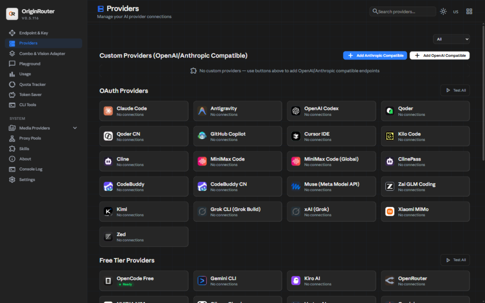

# OriginRouter

<p align="center">
  
</p>

Local AI routing gateway with a dashboard and playground for every provider, combo and
fallback you configure. One OpenAI-compatible endpoint in front of it all. Everything runs
on your machine — chats, keys and router data stay local.

## Install (recommended)

Two per-user Windows installers, both built from this repository and published on the
[releases page](https://github.com/origin-labs-ai/origin-router-suite/releases/latest):

| Installer | What it installs |
|---|---|
| `OriginRouter-Setup-<version>.exe` | Gateway + dashboard. Starts with Windows, self-updates, adds `or` / `originrouter` to your `PATH`. |
| `OriginRouter-Desktop-Setup-<version>.exe` | Desktop window with the same UI. Bundles its own gateway copy, starts it with the system Node runtime, and starts the PandaOrchestrator brain if it is installed. |

Double-click either one, or run it silently:

```powershell
.\OriginRouter-Setup-<version>.exe /VERYSILENT /SUPPRESSMSGBOXES /NORESTART
```

No admin prompt. The gateway installs under `%LOCALAPPDATA%\Programs\OriginRouter` and the
window app under `%LOCALAPPDATA%\Programs\OriginRouter Desktop`; the window's title bar says
**OriginRouter** and nothing else.

After installing, open a **new** terminal (the installer adds its folder to your user `PATH`):

```powershell
or               # short form
originrouter     # same launcher, menu + tray
```

Both start the gateway and the tray icon. Add `--tray` to start without the menu, and
`--skip-update` to keep the launcher from checking the release feed for that run.

### Where it lives

| Data | Path |
|---|---|
| Router DB, settings, logs, cache | `~/.or` |
| Desktop window state (bounds, profile) | `~/.or/desktop` |
| PandaOrchestrator brain state + logs | `~/.or/panda` |
| Update log | `~/.or/updates.log` |

## Auto-update

Installed builds ask the GitHub release feed for the newest version at startup:

```text
https://api.github.com/repos/origin-labs-ai/origin-router-suite/releases/latest
```

When a newer release carries a Windows installer, the app downloads
`OriginRouter-Setup-<version>.exe` to `%TEMP%`, verifies it against the release's
`<installer>.sha256` (or `checksums.sha256`) before running anything, stops its own
processes, installs silently, and relaunches in tray mode. No terminal, no UAC prompt.
Progress goes to `~/.or/updates.log`.

Auto-update is only active for installer builds. A source or global-npm copy updates
manually, and `--skip-update` disables the check for one launch.

## What it does

- **One endpoint, many providers** — `/v1/chat/completions`, `/v1/messages`,
  `/v1/responses`, embeddings, images, TTS/STT and video, translated to each provider's
  own format, with OAuth, API-key, cookie and desktop-lease credentials side by side.
- **Router brain** — Panda (calibrated P(success) / cost / latency from a local ONNX
  profiler), Jev / System One (semantic task classification), or `merged` (both, blended,
  disagreement hedged). Global in **Settings → Routing resilience**, overridable per combo.
  Every mode fails open: a brain that is down, slow or unsure never costs a request, and
  the status panel says which brains are actually contributing.
- **Combos and fallback** — ordered seat pools, least-loaded fan-out, one breaker shared
  per seat across concurrent agents, provider failover, hedging, and a last-resort
  completion so an agent never receives a raw upstream error.
- **Honest model tests** — a dashboard test answers only "did THIS provider serve THIS
  model id": a synthesized last-resort completion is a failure, a timeout is a
  *recheck* verdict rather than a *broken* one, and an answer that came back under a
  different model id reports `answered by: <id>`.
- **Naming system** — every seat is labelled by the model itself: provider heads, vendor
  namespaces, deployment tags (TEE/UC), snapshot dates, quant and build stamps fold away,
  while class words (`flash`, `pro`, `mini`) survive, so `GLM-5.3` and `GLM-5.3 Flash`
  stay two models and every spelling of one model searches as one.
- **Context ceilings** — declared windows are stated per row, so a table's floor is
  never presented as a model's limit.

Feature walkthroughs: [docs/FEATURES.md](docs/FEATURES.md), architecture:
[docs/ARCHITECTURE.md](docs/ARCHITECTURE.md).

## Build from source

Requires Node 22+ and, for the Windows installers,
[Inno Setup 6](https://jrsoftware.org/isdl.php). Run everything from the repository root.

```powershell
npm install                      # app deps
npm run build                    # Next standalone build + postbuild asset copy
npm install --prefix cli
npm run build --prefix cli       # bundles the gateway into cli/app
node scripts/package-cli.mjs --platform=win        # -> dist\win
.\scripts\build-installer.ps1    # -> dist\installer\OriginRouter-Setup-<version>.exe

npm install --prefix desktop     # only for the window app
npm run dist:win --prefix desktop  # -> dist\installer\OriginRouter-Desktop-Setup-<version>.exe

Push-Location cli
npm pack                          # -> cli\originrouter-<version>.tgz
Pop-Location
```

Pack the launcher from **inside** `cli/`: `npm pack --prefix cli` reads the root
`package.json` instead and produces a tarball of the whole repository.

### Publishing the launcher to npm

The launcher's npm identity is **`originrouter`** (the `bin` names, the autostart entry and
`UPDATER_CONFIG.npmPackageName` all use it; `origin-router` on the registry belongs to an
unrelated package and cannot be taken):

```powershell
npm login            # once, in a terminal
Push-Location cli; npm publish; Pop-Location
```

Until that is done, install from the release: run the installer, or
`npm install -g .\originrouter-<version>.tgz` against the release tarball. The gateway's own
self-update never depended on npm — it installs the installer from the GitHub release.

The version comes from `package.json`; `build-installer.ps1` reads it from there unless you
pass `-Version`. Lockfiles are deliberately not committed (see `.gitignore`), so installs
use `npm install`.

Then start the built server directly:

```powershell
$env:PORT = "20128"; $env:HOSTNAME = "0.0.0.0"; npm run start
```

| Path | Default |
|---|---|
| Dashboard | `http://127.0.0.1:20128/dashboard` |
| API | `http://127.0.0.1:20128/v1` |
| Ports in dev | `20127` (`npm run dev`) |

Environment: copy `.env.example` to `.env` first — `INITIAL_PASSWORD` defaults to `123456`
and **must** be overridden on anything that is not on localhost. The full contract is in
`.env.example` and [docs/ARCHITECTURE.md](docs/ARCHITECTURE.md).

## Tests

`tests/` is its own package (vitest) and is not wired into `npm test`:

```powershell
npm install                      # root deps first - tests import from src/
cd tests; npm install            # then the suite's own deps
npx vitest run unit/model-test-strict-honesty.test.js
npx vitest run                   # whole suite
```

The suite is not expected to be green on a fresh checkout of any OS; judge changes with
the baselines in `tests/__baseline__/` (`verify-providers.mjs`, `verify-alias.mjs`,
`verify-oauth-urls.mjs`) plus the runnable contracts `tests/tmp-name-rules.mjs` (naming),
`tests/tmp-stall-rule.mjs` (combo stall) and `tests/tmp-router-proof.mjs` (brain modes).
Release evidence for each cut lives in [docs/RELEASE-LOG.md](docs/RELEASE-LOG.md).

## LAN access

Endpoint page → **Allow access from this network**. Devices on the same network can then
open the dashboard at the printed URL; the gateway keeps deriving the client IP from the
socket so a spoofed `X-Forwarded-For` cannot fake a loopback request.

## Docs

- [docs/INSTALL.md](docs/INSTALL.md) — installers, silent update, `PATH`, firewall, troubleshooting
- [docs/FEATURES.md](docs/FEATURES.md) — LAN toggle, context filter, API keys, playground
- [docs/UPDATES.md](docs/UPDATES.md) — release feed, checksums, update logs
- [docs/RELEASE-LOG.md](docs/RELEASE-LOG.md) — what shipped in each cut and how it was verified
- [docs/ARCHITECTURE.md](docs/ARCHITECTURE.md) — request lifecycle, combo/account fallback, OAuth, data model
- [DOCKER.md](DOCKER.md) — container build and runtime
- [gitbook/](gitbook/) — multilingual documentation site source
