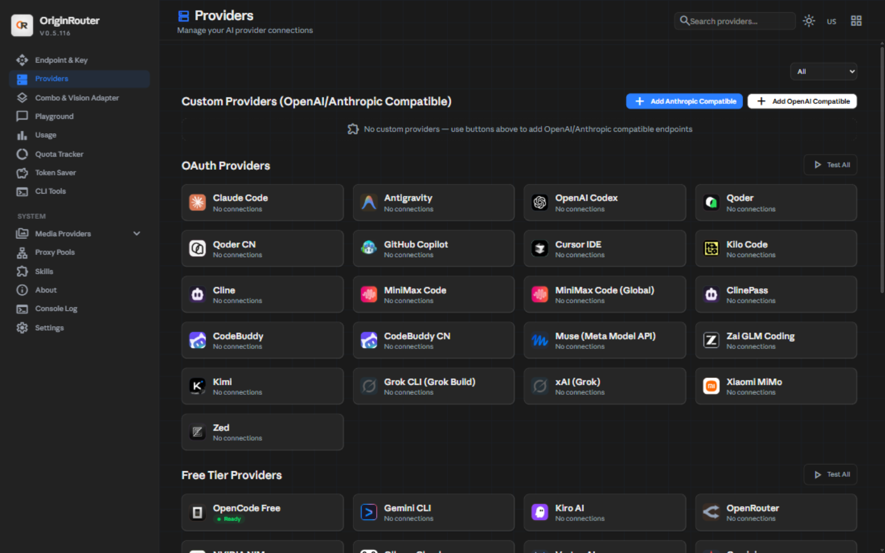

# Features

## Screenshots

| | |
|---|---|
|  |  |
| The gateway dashboard: providers, combos, usage. | A model combo resolving across seats, with per-member routing state. |

## Playground model selector

`/dashboard/playground` opens a model menu with:

- provider groups that show the **name you configured** (never a raw
  `openai-compatible-chat-…` id),
- all connected providers, with a **Show all N models** button per group,
- **Thinking** and **Extended thinking** switches,
- **Max context limit** (`Any`, `32K`, `64K`, `128K`, `200K`, `256K`, `512K`, `1M`),
- human names derived from ids: `claude-fable-5-1` → `Claude Fable 5.1`,
  `glm-5.3-flash` → `GLM 5.3 Flash`.

The selected model name is shown in the header. Provider pages deliberately keep the raw model
id until a display name is set.

## Context windows

Every model advertises at least **1,000,000 tokens** of context. The floor is applied in:

- `/api/models` (dashboard picker),
- `/v1/models` and `/v1/models/info` (`context_length`),
- `/v1beta/models` (`inputTokenLimit`),
- combo member validation (`findSeatsBelowContext`).

Combos with an explicit ceiling still publish that ceiling. Existing combos can be raised to 1M
in the combo editor.

## History and chats

- Rename a chat from History (pencil).
- Delete a single chat (trash next to the pencil).
- **Clear all** deletes every stored chat after confirmation.
- Editing a user message rewrites that turn and everything after it.
- Deleting a user message also removes its answer.

## API keys

Endpoint → API Keys.

- Pencil = rename; the secret value does not change.
- The new name appears in Usage → Logs, in the **API Key** column, and in usage reports.
- Pause/resume and access restrictions are unchanged.

## LAN access

Endpoint → **Allow access from this network**.

When ON, a phone or another PC on the same Wi-Fi/LAN can open the URL shown on the card
(for example `http://10.117.175.241:20128`). The dashboard login is still required.

When OFF, private-network peers receive:

```text
HTTP 403 — LAN access is disabled
```

Only loopback (`localhost`) can use the dashboard.

The URL is selected from a real Wi-Fi/Ethernet adapter. VMware, VirtualBox, Hyper-V, WSL,
Bluetooth and `169.254.x.x` link-local adapters are skipped/deprioritised.

### Firewall

The toggle blocks requests inside OriginRouter; it does **not** add a Windows Firewall rule.
If the phone cannot open the URL, allow Node.js or TCP port 20128 for **Private** networks in
Windows Defender Firewall. Guest/isolated Wi-Fi networks may also block device-to-device traffic.

## Desktop window

`OriginRouter-Desktop-Setup-<version>.exe` installs a separate Electron window that shows the
same dashboard UI. The window title is exactly **OriginRouter** (no “AI Infrastructure
Management” suffix or tagline).

- It bundles a gateway copy under `resources\server`.
- It starts that gateway with the **system Node** executable, not Electron's embedded Node, so
  `node:sqlite` / `sql.js` is available. This fixes
  `[DB] No SQLite driver available (bun/better/node/sql.js all failed)`.
- If the server installer's gateway is already running, the desktop window reuses it.
- Window bounds persist in `~/.or/desktop/window-bounds.json`.
- Closing the window stops only the bundled gateway it launched itself.

## Theme and toggles

- Brand accent: `rgb(43, 127, 255)` / `#2B7FFF`.
- Grey surfaces are unchanged.
- Every switch uses the same 36×20 track and 16px thumb as the playground.
- Tailscale failure shows **Tailscale offline** with a retry action instead of an endless
  “checking…” spinner.
